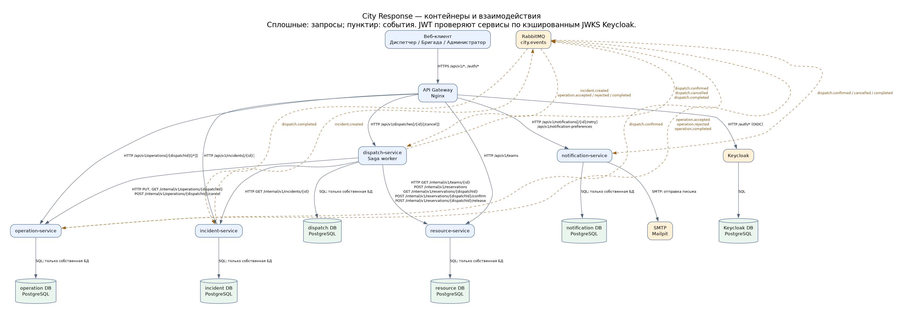
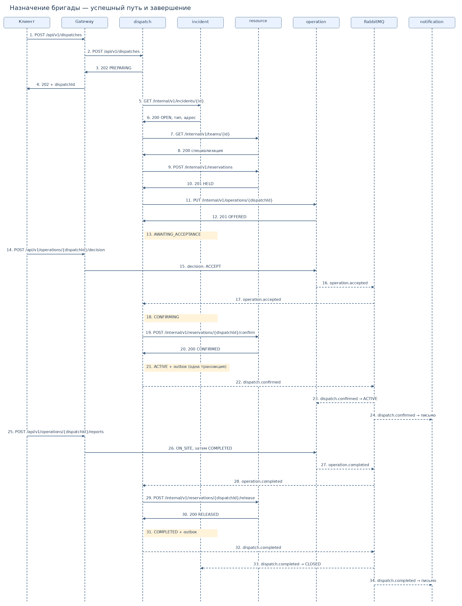
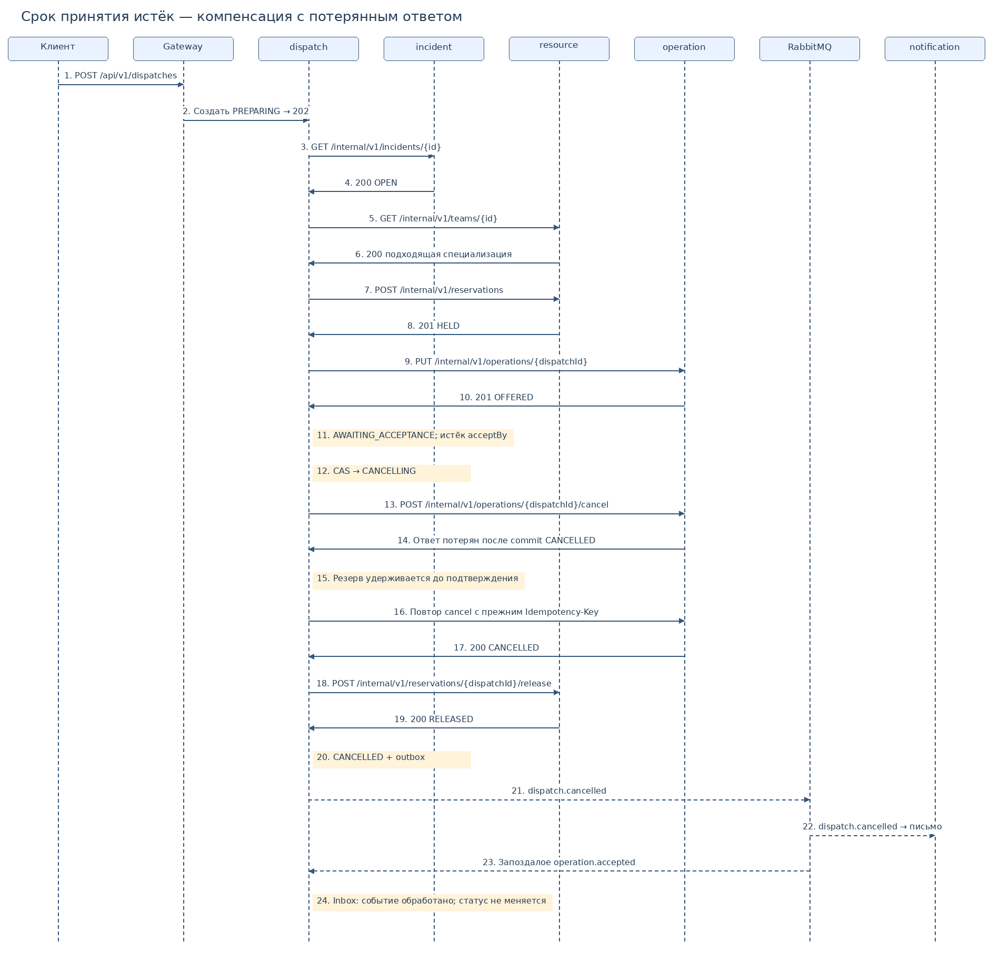

# Система диспетчеризации городских инцидентов

Лабораторная работа №3 — декомпозиция и проектирование микросервисной системы.
Автор: Ilya Klymenko. Дата: 30 октября 2026 года.

Система помогает диспетчеру зарегистрировать городской инцидент, назначить подходящую бригаду и проследить выполнение работ. Бригада принимает предложение, сообщает о прибытии и завершении, а диспетчер получает уведомления. Прототип рассчитан на учебный город: утечки газа, подтопления и упавшие деревья представлены тестовыми заявками. Главный архитектурный сценарий — согласованное назначение одной бригады одному происшествию при отказах отдельных сервисов. Работа содержит проект и контракты для последующей реализации, а не готовую диспетчерскую систему.

Для пересоздания схем: `python scripts/render_diagrams.py` (нужен установленный Graphviz `dot` и Python-зависимости из requirements-dev.txt).

Предметную область необходимо согласовать с преподавателем; факт согласования в этой работе не заявляется.

## 1. Предметная область

### Акторы и границы MVP

| Актор | Возможности |
|---|---|
| Диспетчер (`dispatcher`) | Регистрация происшествий, просмотр бригад, запуск и отмена назначения до активации, наблюдение за работами |
| Бригада (`team`) | Просмотр только собственных заданий, принятие или отказ, отчёты о прибытии и завершении |
| Администратор ресурсов (`resource-admin`) | Добавление бригад и их специализации; комплект техники закреплён за бригадой |
| Оператор системы | Контроль outbox, зависших саг и DLQ; повтор доставки после исправления причины |
| Keycloak | Выдача JWT, роли и service accounts; не бизнес-сервис |
| SMTP-система (Mailpit в учебном стенде) | Приём электронных уведомлений; внешняя относительно бизнес-сервисов система |

Обращение жителя вводит диспетчер. На одно происшествие допускается одно незавершённое назначение; после отмены можно выбрать другую бригаду. У каждой бригады один неделимый комплект техники и одна специализация: GAS, WATER или RESCUE. Выбор бригады делает диспетчер; сервис проверяет соответствие типа происшествия специализации и конкурентную доступность ресурса. Геокодирование, расчёт маршрутов, отдельная аренда техники, платежи и отмена уже начавшей работу бригады вынесены за пределы MVP.

### Пользовательские сценарии

1. Как диспетчер, я хочу зарегистрировать происшествие с адресом и приоритетом, чтобы начать обработку обращения.
2. Как администратор ресурсов, я хочу добавить бригаду со специализацией, чтобы её можно было назначать на подходящие происшествия.
3. Как диспетчер, я хочу выбрать бригаду и начать назначение, чтобы закрепить ресурс за происшествием без двойной брони.
4. Как участник бригады, я хочу принять или отклонить предложение, чтобы подтвердить готовность к работе.
5. Как диспетчер, я хочу отменить ещё не активированное назначение, чтобы освободить ресурс и выбрать другую бригаду.
6. Как участник бригады, я хочу сообщить о прибытии и завершении, чтобы диспетчер видел фактический ход работ.
7. Как диспетчер, я хочу получать уведомления о подтверждении, отмене и завершении назначения, чтобы реагировать на изменения.
8. Как оператор системы, я хочу видеть зависшие саги и неудачные доставки, чтобы восстановить обработку без дублирования назначения.

### Доменные события и контексты

| Контекст | События в прошедшем времени | Основные сущности |
|---|---|---|
| Учёт происшествий | Происшествие зарегистрировано (`incident.created`); закрытие — локальный результат `dispatch.completed` | Incident |
| Управление ресурсами | Ресурс зарезервирован, подтверждён, освобождён — локальные факты транзакций, без публикации в MVP | Team, Reservation, ReservationTombstone |
| Диспетчеризация | Назначение подтверждено (`dispatch.confirmed`), отменено (`dispatch.cancelled`), завершено (`dispatch.completed`) | Dispatch, SagaStep, Inbox, Outbox |
| Выполнение работ | Предложение принято (`operation.accepted`), отклонено (`operation.rejected`), работа завершена (`operation.completed`) | Operation, FieldReport, OperationTombstone |
| Уведомления | Уведомление отправлено/не доставлено — локальные факты | Preference, Notification, DeliveryAttempt |

Не каждый доменный факт обязан становиться интеграционным событием. В брокере используются ровно семь типов из [каталога событий](docs/events.md).

### Глоссарии ограниченных контекстов

| Контекст | Термины и значения |
|---|---|
| Учёт происшествий | **Происшествие** — обращение с адресом и типом; **приоритет** — оценка срочности диспетчером; **закрытие** — обработка события о завершённом назначении; **адрес** — текстовый снимок места обращения |
| Ресурсы | **Бригада** — единица распределения людей и закреплённой техники; **специализация** — допустимый вид работ; **резерв** — исключительное удержание бригады за dispatchId; **освобождение** — терминальное прекращение этого удержания |
| Диспетчеризация | **Назначение** — решение связать происшествие с бригадой; **сага** — сохранённая последовательность локальных транзакций; **срок принятия** — acceptBy, 120 секунд от создания назначения; **компенсация** — отмена предложения и освобождение резерва |
| Выполнение работ | **Предложение** — задание в OFFERED; **принятие** — согласие бригады, ещё не разрешающее выполнение; **активная работа** — задание после dispatch.confirmed; **полевой отчёт** — запись о прибытии или завершении |
| Уведомления | **Получатель** — пользователь с собственными настройками; **уведомление** — логическая доставка одного события пользователю; **попытка** — отдельное обращение к SMTP; **предпочтение** — адрес и согласие получать сообщения |

«Назначение» в dispatch — состояние саги; в operation хранится отдельная модель выполнения с адресом и отчётами. Общего объекта, изменяемого двумя сервисами, нет.

## 2. Карточки сервисов

Нагрузки и задержки ниже — проектные цели для учебного стенда, не результаты измерений. План: 20 диспетчеров, 100 бригад, до 1 000 происшествий в день; максимумы кратковременные. p95 указан для локальных операций без внешнего SMTP.

### incident-service

- **Ответственность:** регистрация и учёт происшествий, закрытие после завершения работ.
- **Владеет:** Incident (адрес, тип, приоритет, статус, время создания), собственные Inbox/Outbox.
- **Предоставляет:** создание, список, чтение; internal-чтение снимка; событие `incident.created`.
- **Зависит:** подписан на `dispatch.completed`; исходящих HTTP-вызовов к бизнес-сервисам нет.
- **Нефункциональные требования:** до 30 чтений/с и 5 записей/с, p95 ≤ 250 мс; регистрация доступна при отказе назначения.
- **Граница:** отдельный жизненный цикл обращения; большая доля чтения; может работать до выбора бригады и без ресурсов.

### resource-service

- **Ответственность:** учёт бригад и атомарное предотвращение двойного резервирования.
- **Владеет:** Team, Reservation, терминальные записи освобождения по dispatchId. Свободность вычисляется по отсутствию HELD/CONFIRMED.
- **Предоставляет:** добавление и список бригад; internal-чтение бригады, создание/чтение/подтверждение/освобождение резерва. Публичного API управления резервами нет.
- **Зависит:** бизнес-сервисы не вызывает, интеграционные события не потребляет и не публикует.
- **Нефункциональные требования:** до 20 чтений/с, 10 резервирований/с, p95 ≤ 200 мс; исключительность резерва важнее доступности записи при отказе БД.
- **Граница:** собственный инвариант доступности, независимая административная функция, локальные транзакции вместо распределённых блокировок.

### dispatch-service

- **Ответственность:** координация назначения и компенсаций, проверка соответствия типа и специализации.
- **Владеет:** Dispatch, шаги и таймеры саги, снимок происшествия, recipientUserId из JWT создателя, локальная проекция новых обращений, Inbox/Outbox.
- **Предоставляет:** запуск, список, чтение, отмена назначения; `dispatch.confirmed`, `dispatch.cancelled`, `dispatch.completed`.
- **Зависит:** HTTP к incident, resource, operation; подписки `incident.created`, `operation.accepted`, `operation.rejected`, `operation.completed`.
- **Нефункциональные требования:** до 5 запусков/с, p95 принятия запроса ≤ 300 мс; 202 возвращается после локальной записи, worker продолжает сагу. Восстановление worker ≤ 30 с после перезапуска.
- **Граница:** координация и политика назначения не принадлежат ни каталогу ресурсов, ни полевой работе; чтения и запуск саги не требуют цепочки HTTP в клиентском запросе.

### operation-service

- **Ответственность:** предложения бригадам, решения бригад, ход работ и история отчётов.
- **Владеет:** Operation, FieldReport, OperationTombstone, Inbox/Outbox. Адрес — неизменяемая копия для выполнения работ.
- **Предоставляет:** internal-создание, чтение, отмена; публичный список, чтение, решение, отчёт; `operation.accepted`, `operation.rejected`, `operation.completed`.
- **Зависит:** подписан на `dispatch.confirmed`, исходящих HTTP-вызовов к сервисам нет.
- **Нефункциональные требования:** до 30 чтений/с и 10 отчётов/с, p95 ≤ 250 мс; ранее активированная работа доступна при отказе dispatch.
- **Граница:** собственная модель и история фактической работы; доступ бригад отличается от доступа диспетчеров; отчёты не требуют запуска логики саги.

### notification-service

- **Ответственность:** настройки получателей, надёжная очередь доставки и история отправок.
- **Владеет:** Preference, Notification, DeliveryAttempt, Inbox. Уникальность (eventId, userId, channel).
- **Предоставляет:** чтение/изменение своих настроек, история, повтор неудачной отправки. Internal HTTP не требуется: интеграция только событиями.
- **Зависит:** `dispatch.confirmed`, `dispatch.cancelled`, `dispatch.completed`; SMTP Mailpit в стенде.
- **Нефункциональные требования:** до 10 событий/с; цель доставки ≤ 10 с при исправном SMTP; сбой доставки не отменяет работы.
- **Граница:** внешняя интеграция и собственная политика повторов, независимое масштабирование отправителей и настройки пользователей.

### Отвергнутые варианты

1. **Объединить dispatch и operation.** Для простого прототипа возможно, но полевые отчёты должны оставаться доступными независимо от worker саги. У сервисов разные модели, роли и изменения: правила подбора ресурсов и форма отчёта меняются независимо.
2. **Отдельные сервисы адресов, техники и статусов.** В MVP адрес — значение в происшествии, техника закреплена за бригадой, статус принадлежит агрегату. Такое дробление дало бы сервисы на таблицу.
3. **Общий сервис пользователей.** Идентичность и роли обеспечивает Keycloak; настройки уведомлений принадлежат notification. Отдельный бизнес-сервис пользователей не нужен.
4. **Автоматический подбор маршрута и GIS.** Усложняет интеграции и не нужен для проверки согласованного назначения. Достаточно выбора бригады диспетчером и проверки специализации.

## 3. Инфраструктура и данные

| Компонент | Кто использует | Обоснование |
|---|---|---|
| PostgreSQL, отдельная БД и отдельный контейнер на каждый сервис | Все 5 сервисов | incident — схема обращения и транзакционный outbox; resource — исключительный резерв; dispatch — долговечные шаги саги; operation — переходы состояния и журнал; notification — дедупликация и попытки доставки |
| RabbitMQ, durable topic exchange `city.events` | incident, dispatch, operation, notification | Небольшой поток, отдельная очередь каждого подписчика, подтверждения доставки и повторная обработка; постоянное воспроизведение всей истории не требуется |
| Nginx как API Gateway | Веб-интерфейс диспетчера и бригады | Единая точка входа, маршрутизация `/api/v1/*`, ограничение частоты, отказ в доступе к `/internal/*`; проверку JWT выполняют сервисы |
| Keycloak и собственная служебная БД | Gateway-проксирование `/auth/*`, все сервисы | Готовая идентификация и роли; JWT проверяется по подписи, issuer, audience, сроку; внутренние service accounts имеют ограниченные права |
| Mailpit | notification-service | Учебная SMTP-система для демонстрации доставки без реальных адресатов; SMTP-сбой можно воспроизвести остановкой контейнера |
| Docker Compose | Весь будущий учебный стенд | Один разработчик, локальное развёртывание, изолированные сети и тома; оркестратор кластера для этой нагрузки не требуется |

Redis, MongoDB, Kafka, поисковый движок и объектное хранилище в MVP не требуются. Резерв хранится в PostgreSQL и не исчезает по TTL: истечение срока сначала запускает безопасную компенсацию. Для уведомлений нужны связи и уникальные ключи, поэтому отдельная документная СУБД не даёт преимущества.

Каждый сервис использует только свои credentials и свою БД; межсервисных SQL-запросов, foreign key и общих таблиц нет. Даже технические inbox/outbox отдельные. Физически в стенде планируются пять контейнеров PostgreSQL с независимыми томами и шестая БД для Keycloak. Внешние порты БД и внутренних API не публикуются. Ссылки на чужие UUID не являются foreign key.

### Инварианты

- В resource только один резерв HELD/CONFIRMED на teamId: частичный UNIQUE INDEX, плюс UNIQUE(dispatchId). Параллельные попытки сериализуются транзакцией; проигравший получает 409.
- В dispatch только одно назначение в PREPARING/AWAITING_ACCEPTANCE/CONFIRMING/ACTIVE/CANCELLING на incidentId. Повторный запуск после CANCELLED получает новый dispatchId.
- В operation только одна операция на dispatchId; отменённый ID не переиспользуется.
- Резерв принадлежит resource, состояние саги — dispatch, фактический ход работы — operation. Копии не получают права изменять источник.
- Бригада приступает к работе только при operation.status=ACTIVE, установленном по `dispatch.confirmed`. ACCEPTED ещё не означает выезд.

## 4. Взаимодействия



[Редактируемый исходник Graphviz](docs/architecture.dot) · [SVG](docs/architecture.svg) · [исходник draw.io](docs/architecture.drawio). Graphviz используется как аналог редактора схем; DOT является источником PNG/SVG, draw.io содержит редактируемые контейнеры и связи той же архитектуры.

Сплошные стрелки — HTTP/SQL/SMTP с подписью; пунктир — сообщения через RabbitMQ с routing key. Бизнес-клиент обращается только к Gateway. Keycloak доступен через `/auth/*` этого же Gateway. Internal HTTP доступен только service accounts внутри сети; JWT проверяется и при межсервисных вызовах.

| № | Инициатор → получатель | Тип | Контракт | Назначение |
|---|---|---|---|---|
| S1 | dispatch → incident | REST | `GET /internal/v1/incidents/{id}` | Проверить OPEN, получить адрес и тип |
| S2 | dispatch → resource | REST | `GET /internal/v1/teams/{id}` | Проверить специализацию |
| S3 | dispatch → resource | REST | `POST /internal/v1/reservations` | Исключительный резерв |
| S4 | dispatch → operation | REST | `PUT /internal/v1/operations/{dispatchId}` | Предложить работу |
| S5 | dispatch → resource | REST | `POST /internal/v1/reservations/{dispatchId}/confirm` | Подтвердить удержание |
| S6 | dispatch → operation | REST | `POST /internal/v1/operations/{dispatchId}/cancel` | Компенсировать предложение |
| S7 | dispatch → resource | REST | `POST /internal/v1/reservations/{dispatchId}/release` | Компенсировать резерв или освободить после завершения |
| S8 | dispatch → operation/resource | REST | `GET /internal/v1/operations/{dispatchId}`, `GET /internal/v1/reservations/{dispatchId}` | Уточнить неизвестный результат |
| A1 | incident → RabbitMQ → dispatch | событие | `incident.created` | Обновить список новых обращений |
| A2 | operation → RabbitMQ → dispatch | событие | `operation.accepted`, `operation.rejected` | Продолжить сагу или компенсировать |
| A3 | dispatch → RabbitMQ → operation, notification | событие | `dispatch.confirmed` | Разрешить выполнение, уведомить |
| A4 | operation → RabbitMQ → dispatch | событие | `operation.completed` | Завершить сагу и освободить бригаду |
| A5 | dispatch → RabbitMQ → incident, notification | событие | `dispatch.completed` | Закрыть происшествие, уведомить |
| A6 | dispatch → RabbitMQ → notification | событие | `dispatch.cancelled` | Сообщить об отмене |

HTTP имеет таймаут соединения 1 с и общий таймаут 3 с. При сетевой ошибке/503 worker делает повторы с задержкой 1, 5, 15 с и тем же Idempotency-Key. После пяти последовательных отказов circuit breaker открывается на 30 с, затем допускает один пробный запрос. При 400/403/409 бесконечного повтора нет; 401 требует обновить service token и однократно повторить. Таймаут не считается доказательством отката. Для компенсаций число циклов восстановления не ограничивается тремя: они остаются в долговечной очереди, после 5 минут поднимается сигнал оператору.

### Успешный сценарий



[Редактируемый исходник](docs/sequence-success.svg)

1. Диспетчер создаёт происшествие; incident сохраняет OPEN и outbox `incident.created` одной транзакцией.
2. Диспетчер выбирает бригаду и вызывает `POST /api/v1/dispatches` через Gateway. dispatch сохраняет PREPARING и возвращает 202. Worker получает снимок происшествия и проверяет специализацию.
3. Worker резервирует бригаду в resource (HELD), создаёт предложение в operation (OFFERED), переводит dispatch в AWAITING_ACCEPTANCE. acceptBy фиксирован при запуске: 120 секунд, время подготовки входит в срок.
4. Бригада принимает предложение через Gateway. operation атомарно записывает ACCEPTED и `operation.accepted` в outbox. Бригада ждёт ACTIVE.
5. dispatch обрабатывает принятие под блокировкой строки саги: проверяет срок и состояние, записывает CONFIRMING. Worker подтверждает резерв (CONFIRMED), затем одной локальной транзакцией пишет ACTIVE и `dispatch.confirmed`. Отмена и эта транзакция сериализуются по dispatchId.
6. operation по событию становится ACTIVE, notification создаёт задачу доставки. SMTP может быть недоступен: назначение остаётся ACTIVE.
7. Бригада отмечает ON_SITE, затем COMPLETED с отчётом. `operation.completed` поступает dispatch, worker освобождает резерв, пишет COMPLETED и `dispatch.completed`. incident закрывает обращение, notification отправляет сообщение.

### Сага и компенсации



[Редактируемый исходник](docs/sequence-failure.svg)

| Шаг / отказ | Сохранённое состояние | Восстановление и компенсация |
|---|---|---|
| До создания dispatch: БД недоступна | Назначение не подтверждено клиенту | 503; клиент повторяет с прежним Idempotency-Key |
| Чтение происшествия/бригады неуспешно | PREPARING, ресурсов ещё нет | Повтор при временном сбое; неверный тип/404/закрытое обращение → отмена, без ресурса |
| Резерв занят (409) | PREPARING | Переход CANCELLING, безопасное закрытие данного dispatchId, CANCELLED; диспетчер выбирает другую бригаду |
| Резерв сохранён, HTTP-ответ потерян | PREPARING, результат неизвестен | GET по dispatchId или повтор POST с тем же ключом; при отмене release записывает tombstone даже если поздний reserve ещё в пути |
| Создание предложения отклонено или ответ потерян | HELD; OFFERED мог сохраниться | Уточнить GET /operations/{dispatchId}; при невозможности продолжить сначала cancel operation, затем release resource |
| Истёк acceptBy или бригада отказала | AWAITING_ACCEPTANCE/CONFIRMING | CAS состояния в CANCELLING; сначала отменить operation, затем освободить resource, затем CANCELLED и событие |
| Подтверждение резерва не удалось | CONFIRMING; operation ACCEPTED | Уточнить ресурс; повтор до срока. После срока — та же компенсация. Если CONFIRMED успел сохраниться, release освобождает и его |
| Резерв подтверждён, dispatch упал до ACTIVE | CONFIRMING | Worker восстановит шаг; если срок прошёл, компенсирует. Пока ACTIVE + outbox не зафиксированы, operation не начинает работу |
| Брокер недоступен после записи ACTIVE | ACTIVE, событие в outbox | Издатель повторяет после восстановления; ресурс удерживается, отмена ACTIVE запрещена. Нельзя освобождать резерв по таймауту доставки |
| operation не получает dispatch.confirmed | ACTIVE в dispatch, ACCEPTED в operation | Очередь сохраняет сообщение; после восстановления активирует. Это безопасная задержка, не основание для отмены |
| Поздний ACCEPT после начала компенсации | CANCELLING/CANCELLED | Событие фиксируется в inbox и игнорируется. Operation отменяется до освобождения ресурса; позднее принятие не возвращает ACTIVE |
| cancel operation недоступен | CANCELLING, резерв удерживается | Повтор cancel; ресурс нельзя освобождать до подтверждения отмены. 409 ACTIVE/ON_SITE/COMPLETED → сигнал оператору, ресурс сохраняется |
| release resource недоступен | CANCELLING либо незавершённая обработка COMPLETED | Повтор из сохранённого шага; финальный статус и событие публикуются только после подтверждённого освобождения |
| operation.completed доставлен, dispatch упал | operation уже COMPLETED | Inbox и состояние шага записываются атомарно; worker продолжает освобождение. Второе событие не запускает вторую работу |
| Закрытие incident или SMTP временно недоступны | Dispatch COMPLETED, событие сохранено | Независимые очереди и повторы. Устаревший OPEN не позволяет повторно назначить: dispatch хранит завершение incidentId и отклоняет новый запуск |
| Компенсация выполнена, ответ потерян | Сага ещё CANCELLING | Повтор cancel/release идемпотентен; терминальная tombstone блокирует запоздалое создание |

Состояния dispatch: `PREPARING → AWAITING_ACCEPTANCE → CONFIRMING → ACTIVE → COMPLETED`; до ACTIVE возможен переход в `CANCELLING → CANCELLED`. Результат принятия, пришедший во время PREPARING после создания OFFERED, сохраняется как pending decision в той же транзакции inbox; worker применяет его после AWAITING_ACCEPTANCE. Таймер отмены проверяет PREPARING, AWAITING_ACCEPTANCE и CONFIRMING. При гонке таймера и подтверждения победителя определяет локальная транзакция dispatch; ACTIVE терминален для отмены в MVP.

Каждый side effect шага имеет детерминированный ключ UUID от `(dispatchId, stepName)`. Worker использует lease строки шага и сохраняет результат; истёкший lease допускает восстановление другим worker. Двойной запуск worker безопасен из-за бизнес-уникальности и idempotency получателя. Reserve, confirm и release сериализуются по dispatchId, в том числе при ещё отсутствующей записи (advisory transaction lock или отдельная строка ключа). Аналогичная сериализация применяется к create/cancel операции. Tombstone бессрочна для данного UUID и не позволяет позднему запросу восстановить отменённую работу.

Inbox с уникальным eventId записывается в той же транзакции, что изменение агрегата/шага. Outbox создаётся в транзакции состояния; relay публикует persistent-сообщение с publisher confirms и помечает отправку. Сбой между публикацией и отметкой создаёт дубль, который поглощается inbox. ACK отправляется после commit. После пяти неудачных обработок применяется DLQ и ручной redrive с прежним eventId. SMTP не поддерживает гарантированную exactly-once отправку: при потере ответа возможен повтор письма; стабильный Message-ID облегчает распознавание дубля. Бизнес-действия при этом не повторяются.

## 5. Контракты API

| Сервис | OpenAPI |
|---|---|
| Происшествия | [incident-service.yaml](api/incident-service.yaml) |
| Ресурсы | [resource-service.yaml](api/resource-service.yaml) |
| Диспетчеризация | [dispatch-service.yaml](api/dispatch-service.yaml) |
| Выполнение работ | [operation-service.yaml](api/operation-service.yaml) |
| Уведомления | [notification-service.yaml](api/notification-service.yaml) |

[Все 26 HTTP-операций](docs/api-index.md) · [7 интеграционных событий, издатели и очереди](docs/events.md).

OpenAPI 3.0.3 выбран для совместимости редакторов. Каждый контракт содержит тело запроса там, где оно нужно, параметры, примеры ответов, ошибки, JWT security scheme. GET и POST-команды без payload не требуют искусственного тела. Внутренние операции имеют тег `internal` и собственный server URL. У notification нет внутреннего HTTP: события описаны в схемах издателей, а подписки — в каталоге.

Общая модель Problem одинакова во всех пяти файлах: type, title, status, detail, instance, traceId. HTTP-коды: 400 — формат запроса, 401 — токен, 403 — права, 404 — отсутствие объекта, 409 — состояние/конкуренция/несовместимое повторное тело, 503 — временная недоступность. Gateway дополнительно возвращает 429 при превышении лимита и 502/504 при сбое upstream, в той же модели Problem; Retry-After задаёт задержку повтора 429/503. Для 204 тело отсутствует.

Idempotency-Key обязателен для всех изменяющих операций; область ключа — principal + method + path, хранение результата минимум 7 суток. Тот же ключ и тело возвращают исходный код и тело, даже если объект уже изменился; актуальный статус получают GET. Другой payload с прежним ключом → 409. Бизнес-уникальность dispatchId и tombstone действует дольше срока ключа. При повторе с новым ключом применяются текущие правила переходов, поэтому автоматический повтор использует исходный ключ.

Списки используют page (от 1) и size (1–100, по умолчанию 20), возвращают items/page/size/total. Сортировка по createdAt DESC, id DESC; для operations вместо id используется dispatchId. Для teams и notifications createdAt также хранится в БД, даже если поле не выдаётся в Team. Пагинация выполняется после ограничения по правам. Страницы не являются снимком: при параллельных вставках возможен сдвиг, что допустимо для учебного журнала.

### Проверка и просмотр

```sh
npm ci --ignore-scripts
npm run lint
python -m pip install -r requirements-dev.txt
npm run check
```

[Результаты фактической проверки](docs/validation.md). Для визуальной проверки импортировать каждый `api/*-service.yaml` в [Swagger Editor](https://editor.swagger.io/) через File → Import file. При отсутствии доступа к браузеру этот шаг нужно выполнить отдельно; статус указан в протоколе, автоматическая проверка его не подменяет.

### Соответствие заданию

| Требование | Где выполнено |
|---|---|
| 4–7 бизнес-сервисов | 5 карточек, 5 API-файлов и 5 отдельных БД |
| ≥3 межсервисных синхронных взаимодействий | S1, S2, S3, S4, S5 и компенсации; клиентские запросы не учитываются |
| ≥2 асинхронных взаимодействий | A1–A6, отдельные очереди подписчиков |
| Сквозной сценарий ≥3 сервисов | dispatch + incident + resource + operation; notification — асинхронное продолжение |
| Поведение при сбое на каждом шаге | Таблица саги, sequence-failure |
| 3–5 предложений описания, акторы, 5–8 сценариев | Введение, раздел 1, 8 сценариев |
| Контексты, события, глоссарии | Раздел 1 и docs/events.md |
| Карточки, границы, отвергнутые варианты | Раздел 2 |
| Обоснованный выбор ПО | Раздел 3 |
| Архитектурная и две sequence-схемы | docs/architecture.*, docs/sequence-*.png и SVG |
| API, ошибки, идемпотентность, пагинация, примеры | Раздел 5 и пять OpenAPI |
| Линтер и Swagger Editor | docs/validation.md содержит отдельно проверенные и недоступные шаги |
| Репозиторий для следующих лабораторных | Самостоятельный Git-репозиторий; бизнес-код будет добавлен позже |

## Источники

- Методические указания «Лабораторная работа №3. Декомпозиция и проектирование микросервисной системы», предоставленные преподавателем.
- [OpenAPI 3.0.3](https://spec.openapis.org/oas/v3.0.3.html) — структура HTTP-контрактов и компонентов.
- [RabbitMQ: publisher confirms и consumer acknowledgements](https://www.rabbitmq.com/docs/confirms) — подтверждения доставки и обработки.
- [PostgreSQL: ограничения](https://www.postgresql.org/docs/current/ddl-constraints.html) — локальная целостность и уникальность.

Конкретные таймауты, нагрузки, состав сервисов и алгоритм саги являются проектными решениями этой работы.
